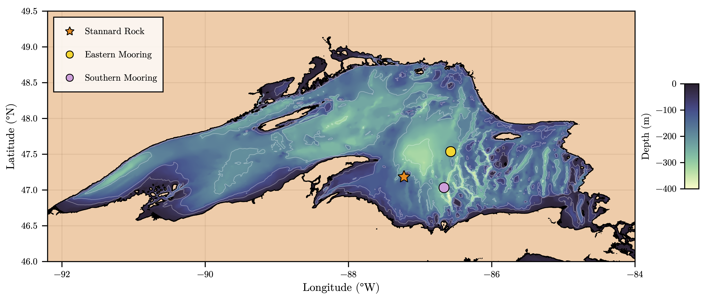

# Pringle-etal_2026_GRL

**Drivers of Deep-Water Cooling and Model Bias in Lake Superior**

William J. Pringle1\*, [GLEAM Team 1](https://compass.pnnl.gov/GLM/Team)1,2,3

1 Environmental Science Division, Argonne National Laboratory, Lemont, IL, USA.
2 Department of Civil, Environmental and Geospatial Engineering, Michigan Technological University, Houghton, MI, USA.
3 Pacific Northwest National Laboratory, Richland, WA, USA.

\* corresponding author:  wpringle@anl.gov

## Abstract
The transition from fall overturn to winter stratification influences subsequent ice formation and spring warming timing in deep dimictic lakes. We investigate the drivers of modeled deep-water temperature bias during this transition in Lake Superior using observations from two subsurface moorings and high-quality surface flux measurements. Large-eddy simulations (LES), a $k-\varepsilon$ turbulence-closure column model, and an analytical bottom-temperature model are evaluated over 60-day winter periods. At the 212-m Eastern Mooring, modeled temperature profiles and bottom-temperature evolution generally agree well with observations, although the hydrodynamic models, particularly LES, underestimate mixing. Including thermobaricity and accurate wind direction improves the simulated thermal structure and reduces deep-water warm bias. At the 384-m Southern Mooring, substantial warm biases persist, indicating that surface forcing and vertical mixing alone are insufficient. Horizontal processes associated with nearby steep bathymetry may be important. Results highlight the sensitivity of winter stratification to wind forcing, thermobaricity, and three-dimensional lake dynamics.

## Journal reference
_your journal reference_

## Code reference
- Pringle, W. J. (2026). Lake_Superior_Winter_Cooling [Software]. Zenodo. https://doi.org/some-doi-number

## Data reference

### Input data
- Austin, J., & Elmer, C (2023). Lake Superior moored temperature and currents, Sep 2005-May 2015 [Data set]. University Digital Conservancy. https://doi.org/10.13020/zqw9-mk81
- Spence, C., Lenters, J., & Nicholls, E. (2024). US-GL1: Stannard Rock, 2008 - 2022 [Data set]. Ameriflux. https://ameriflux.lbl.gov/sites/siteinfo/US-GL1

### Preprocessing
Input data has been preprocessed and added to `data` directory.
It is also possible to run the following scripts to preprocess the raw subsurface mooring and surface flux [input data](#input-data), e.g., if modification to preprocessing is desired.

| Script Name | Description | How to Run |
| --- | --- | --- |
| `scripts/fill_fluxes.py` | Gap-fills surface flux data | `python3 fill_fluxes.py [input.nc] [output.nc]` |
| `scripts/process_lake_superior_southern_eastern_moorings.jl` | Processes mooring temperature profiles | `julia process_lake_superior_southern_eastern_moorings.jl` |

### Output data
- Pringle, W. J. (2026). My output dataset name [Data set]. Zenodo. https://doi.org/some-doi-number

## Contributing modeling software
| Model | Version | Code | Documentation |
|-------|---------|-----------------|-----|
| Oceananigans.jl | [0.95.3](https://github.com/CliMA/Oceananigans.jl/releases/tag/v0.95.3) | [Github](https://github.com/CliMA/Oceananigans.jl) | [HomePage](https://clima.github.io/OceananigansDocumentation/) |

## Reproduce my experiment
1. Install the software components required to conduct the experiment from [contributing modeling software](#contributing-modeling-software)
2. Optional: Download and preprocess raw [input data](#input-data) required to conduct the experiment (already in `data` directory).
3. Run the Julia `.jl` scripts located in the `scripts` directory (`TURB_experiment` (vertical mixing column model) and `LES_experiment` subdirectories) directly or adapt the PBS job scripts provided to run through all the simulated experiments from the paper. 
4. Download and unzip the [output data](#output-data) from my experiment to compare outputs to those from the publication

## Reproduce my figures
Use the Julia `.jl` scripts found in the `figures` directory to reproduce the figures used in this publication. Filenames of the scripts are numbered to match the figure numbers from the paper.
